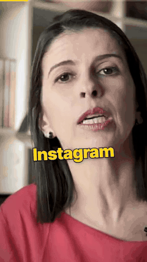
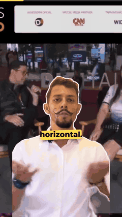
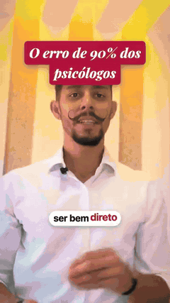

# KLAP Editor

**Editor de Reels por template que roda dentro do Claude Code, no seu Mac.**
Você grava sem editar (pode errar e repetir), escolhe o modelo, manda o vídeo, e o Claude:
corta pausas e erros, acelera 1.2x sem mudar a voz, limpa o áudio, enquadra no rosto, recorta você do fundo,
coloca legenda animada, título com marca-texto, transições, efeitos sonoros, emojis, cards animados, música que
abaixa quando você fala e um CTA no final. Se faltar imagem ou vídeo de apoio, ele busca sozinho na internet
(só material de licença livre, com crédito). Antes de gerar o vídeo final ele abre um **storyboard cena por cena +
prévia** para você aprovar ou pedir mudanças em português ("cena 3 troca o fundo", "legenda maior").

| Yap elaborado | Tela verde | Tela dividida elegante |
|---|---|---|
|  |  |  |
| você em tela cheia, zoom, palavra por palavra, notificação, busca digitando, carimbo, lista | você recortado (contorno de figurinha) na frente do vídeo que está comentando | imagem em cima num cartão, você embaixo, palavras-chave grandes |

Abra `skills/klap-base/catalogo.html` no navegador para ver os exemplos tocando e copiar os comandos.

## Comandos

| comando | o que faz |
|---|---|
| `/klap` | o menu: pergunta o modelo, pede o vídeo e faz tudo; sem vídeo ainda, escreve o roteiro para o seu nicho |
| `/yap` | opinião, dica, storytime: tela cheia com cortes, zoom e uma palavra por vez ao lado do rosto |
| `/telaverde` | react/comentário: você recortado na frente do vídeo comentado (ou de fundos ilustrativos) |
| `/teladividida` | explicação com prova visual: mídia em cima, você embaixo |
| `/klap-base` | "imparável": só o corte limpo (pausas, erros, 1.2x, áudio) |

Exemplo: arraste o vídeo no chat do Claude Code e digite `/telaverde quero que o título seja: não é possível que isso virou moda`.

## Instalação

Requisitos: **macOS** (Apple Silicon recomendado), [Claude Code](https://claude.com/claude-code), [Homebrew](https://brew.sh)
e as Command Line Tools (`xcode-select --install`).

```bash
git clone https://github.com/tanfgoncalves/klap-editor.git ~/klap-editor
cd ~/klap-editor
./install.sh
```

O instalador confere e (com sua permissão) instala `ffmpeg`, `whisper-cpp`, `yt-dlp` e `node` pelo Homebrew,
compila o utilitário de recorte (Swift + Vision da Apple, nada de modelo extra), instala o Remotion, baixa o modelo
de transcrição Whisper large-v3-turbo (~570 MB, uma vez só) e liga as skills em `~/.claude/skills`.
Para atualizar depois: `cd ~/klap-editor && git pull` (as skills são links para a pasta).
Já tem o modelo do Whisper? `KLAP_WHISPER_MODEL=/caminho/ggml-large-v3-turbo-q5_0.bin ./install.sh`.

## Como funciona

```
vídeo bruto ──> prep (enquadra no rosto, 1080x1920, transcreve com Whisper)
            ──> cut (tira pausas e retakes, 1.2x sem mudar a voz, limpa o áudio, transcreve de novo)
            ──> matte (recorte da pessoa com o Vision da Apple + contorno branco)      [tela verde]
            ──> autoplan + Claude (cenas, mídia certa na hora certa, elementos animados, sons, CTA) -> plan.json
            ──> preview (prévia leve + storyboard.html)  ──>  você aprova  ──>  render (1080x1920 H.264)
```

Tudo fica numa pasta por vídeo em `~/Movies/KLAP Editor/`. O `plan.json` é o estado do vídeo: o Claude edita esse
arquivo quando você pede mudanças. O motor é `skills/klap-base/motor/klap.py` (Python, só biblioteca padrão) +
`remotion/` (React/Remotion) + `klapvision.swift`. Tempo típico num Mac M-series: prévia ~1 min, final ~2 a 3 min
para 30 s de vídeo.

Busca de mídia (`klap.py buscar`): vídeos de banco do [Mixkit](https://mixkit.co) (só os da licença livre),
imagens e músicas do [Openverse](https://openverse.org) e Wikimedia Commons (CC0, domínio público, CC BY, CC BY-SA)
e trechos de vídeos Creative Commons do YouTube. Os créditos ficam em `creditos.txt` dentro de cada projeto: cole na
legenda do post quando a licença pedir atribuição.

## Limitações

- Só macOS (o recorte usa o Vision da Apple).
- Instagram não baixa direto (precisa de login): mande o arquivo.
- O Whisper às vezes erra nomes e gírias; o Claude corrige o que percebe, mas confira a legenda no storyboard.
- Vídeo de outra pessoa comentado na tela verde é responsabilidade de quem publica (em YouTube pode dar Content ID).

## Créditos e licenças

- Código: MIT (veja `LICENSE`).
- Fontes: Montserrat, Inter Tight, Playfair Display e Caveat, SIL Open Font License (licenças em `motor/fonts/`).
- Efeitos sonoros: gerados pelo próprio editor com ffmpeg (sem direitos de terceiros).
- Vídeos dos exemplos: trechos de vídeos Creative Commons Attribution (CC BY) do YouTube de Caroline Caracas
  ("Como Ganhar Seguidores no Instagram em 2019 - 10 DICAS!"), Brendo Nathan ("O Segredo para Escalar seu
  Consultório") e Digitalks (entrevista Talita Lombardi), editados pelo KLAP Editor; imagens via Openverse
  (rawpixel/StockSnap CC0, Wikimedia CC BY-SA 4.0 "Occupational therapist helping a client", Mangionekd).
